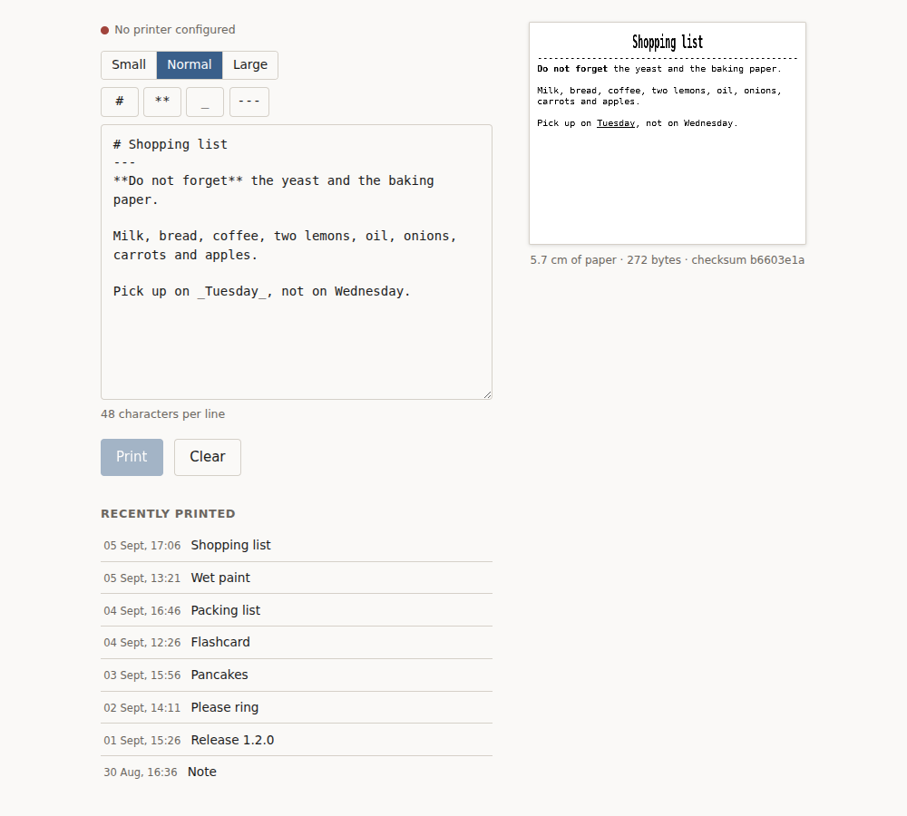

# thermal-receipt-webui


Type free text, watch an 80 mm receipt take shape next to it, and send it to an
ESC/POS thermal printer. The preview renders the byte stream the printer will
receive, not a drawing of what it might look like.



*The interface at the normal size, with no printer configured: the lamp is red and
the print button is off because `RECEIPT_PRINTER` was left empty. Everything else
behaves exactly as it does with a printer attached. Timestamps in the history follow
the viewer's locale; this shot was taken with an en-GB one.*

## Why this exists

Receipt layout is fiddly. Font A on an 80 mm roll gives you 48 characters, double
width halves that, and the only way to find out that your heading does not fit is
usually to print it. A roll of thermal paper and twenty minutes later you have a
layout and a bin full of drafts.

Most preview tools solve this by drawing what they think the printer will do. That
works until it does not, and then the picture and the paper disagree in a way that
is hard to see. This one takes the other route: `python-escpos` produces the real
byte stream, and the renderer parses those same bytes back into an image. If the
picture is wrong, the paper is wrong in exactly the same way.

## Features

- **Live preview** that follows along as you type, rendered server side from the
  actual ESC/POS bytes.
- **A checksum ties the preview to the print.** The preview reports the SHA-256
  prefix of the bytes it drew. The print endpoint recomputes it and refuses the job
  with HTTP 409 if the text changed in between.
- **Markdown subset** for markup, so there is no dialect to memorise: `#` for
  headings, `---` for a rule, `**bold**` and `_underlined_` inline.
- **Three type sizes**, 64, 48 or 24 columns, with the current column count shown
  under the editor.
- **History of the last 20 receipts** that restores the text and the size it was
  printed at, so a reprint produces the same bytes.
- **Command line tool** for rendering a PNG or sending to a printer, with three
  sample receipts as a layout test bench.
- **Text files can be dropped on the editor**, read in the browser: no upload
  endpoint, no server side file access. The command line reads stdin.
- **Typographic characters are translated** to what the code page can print, so
  text pasted from anywhere does not arrive full of question marks.
- **A contract for automated senders**: idempotency keys so a retry costs no
  paper, announced jobs with a paper budget of their own, a counter to resume from
  after an interruption, and one response shape across every endpoint.
- **The printer is asked about paper, cover and faults** over DLE EOT before
  anything is sent, so an empty roll is a refusal instead of a silent loss.
- **No printer required** to develop layouts, or to run the interface.

## Known Limitations

> [!IMPORTANT]
> **The cell metrics have not been verified against a device.** Font A is taken to
> be 12x24 dots and Font B 9x17, from the TM-T20IV datasheet. The line feed has
> been measured on paper, the character cells have not. What *is* verified is
> that the preview renders the same byte stream the printer receives, and that the
> print path compares a checksum before sending. `FONT_CELLS` in
> `src/receipt/preview.py` is the single place to correct if the datasheet is
> wrong.

- **No authentication.** Anyone who can reach the port can print. Bind to localhost
  and put a reverse proxy in front of it; see `examples/nginx.conf` and
  [SECURITY.md](SECURITY.md). The paper budget is what limits a runaway sender, and
  `audit.jsonl` is what makes it traceable - neither is a substitute for a door.
- **The paper budget counts per source IP**, which it reads from the rightmost
  element of `X-Forwarded-For`. Without a reverse proxy that overwrites or appends
  that header, a caller can pick its own bucket.
- **An HTTP 200 means the bytes were handed over, not that the receipt is on the
  paper.** The printer buffers. A job therefore carries `last_seq` for what went out
  and `confirmed_seq` for what provably came through; see the contract below.
- **No italic.** ESC/POS has no italic command and the character generator has no
  italic face. `_text_`, which Markdown reads as italic, underlines here instead,
  because that is the emphasis the device actually has.
- **Raster images and QR codes are not drawn.** `GS v 0` and `GS (` are parsed for
  their length so the rest of the stream still renders, but they leave no mark on
  the preview and no space either, so the reported paper length falls short for a
  receipt holding one.
- **Tested against one model.** The layout assumes 80 mm paper at 203 dpi with a
  576 dot print width. Other widths need `WIDTH_DOTS` changed in two places.
- **Paper length is a lower bound.** The preview counts what the byte stream
  produces, using the device's line feed of `LINE_FEED_DOTS` per line. What the
  printer feeds on top, so the cut lands behind the last line, is added by the
  device. `LINE_FEED_DOTS` is 30, which two prints on a TM-T20IV confirmed in
  both fonts. If your model advances a different amount per line, correct that
  constant in `src/receipt/preview.py`.

## Quick Start

```bash
git clone https://github.com/fidpa/thermal-receipt-webui.git
cd thermal-receipt-webui

python3 -m venv .venv
.venv/bin/pip install -r requirements.txt

# Preview only, no printer needed
PYTHONPATH=src .venv/bin/python -m receipt.web
# then open http://127.0.0.1:8094/

# With a printer
PYTHONPATH=src .venv/bin/python -m receipt.web --printer 192.0.2.50
```

Rendering a receipt to a PNG needs nothing running at all:

```bash
echo "Milk, bread, coffee" | PYTHONPATH=src .venv/bin/python -m receipt.cli - \
    --title Shopping --preview /tmp/shopping.png
```

The renderer draws text with DejaVu Sans Mono, which most distributions install as
`fonts-dejavu-core`. Without it the preview raises on the first glyph.

## Markup

| Input | On paper |
|-------|----------|
| `# Heading` | centered, bold, double height |
| `## Heading` | centered, bold |
| `### Heading` | flush left, bold |
| `---` | a rule across the full width |
| `**bold**` | bold, mid-sentence as well |
| `_underlined_` | underlined, mid-sentence as well |
| blank line | a blank line |

Consecutive lines join into one paragraph and are wrapped to the receipt width, so
a textarea does not turn into ragged fragments. The two kinds of emphasis nest in
either order, `**_like this_**` as well as `_**like this**_`. The underscore needs
word boundaries, exactly as in Markdown, so `snake_case_name` is left alone. An
unpaired `**` or `_` is printed rather than reported as an error.

Characters CP858 cannot represent are mapped onto their ASCII image before the
layout runs: en and em dashes to `-`, curly quotes to `"` and `'`, an ellipsis to
`...`, bullets to `-`, arrows to `->`, fixed width spaces to ordinary ones, and a
byte order mark disappears. What the code page does cover - umlauts, `«»`, `°`,
`±`, `€` - is left alone. An emoji has no ASCII image and stays a `?`, which the
preview shows before any paper is spent. The table is `normalize()` in
`src/receipt/markup.py`, on the one path both the preview and the print take.

## Font sizes

The size applies to the whole receipt. There is deliberately no size markup inside
the text.

| Size | Font | Scale | Columns | Good for |
|------|------|-------|---------|----------|
| Small | B, 9x17 dots | 1x | 64 | longer texts, lists, records |
| Normal | A, 12x24 dots | 1x | 48 | everything else |
| Large | A, 12x24 dots | 2x | 24 | signs, reminders, single sentences |

Smaller than Font B is not possible: the device has no third font. Larger is, in
principle, `GS !` scales up to 8x, but 3x leaves 16 columns and 4x leaves 12, which
is not enough for a sentence.

## How the preview stays honest

Text becomes bytes in exactly one function, `build()` in `src/receipt/web.py`. Both
the preview and the print endpoint call it and nothing else.

```
text ──> build() ──> ESC/POS bytes ──┬──> preview.render() ──> PNG in the browser
                                     │
                                     └──> printer.send_to_printer() ──> port 9100
                                          only if the checksum still matches
```

The preview response carries `sha`, the first eight hex digits of the SHA-256 of
those bytes, and the interface shows it under the paper. When you press print, the
browser sends that value back. The server rebuilds the bytes from the text it was
given, compares, and answers 409 without sending anything if they differ.

Two rules keep the two paths from drifting apart, and both are pinned by tests:

- No layout primitive writes more columns into a line than the receipt is wide. An
  over-long line is where the trouble starts, because the printer wraps it while the
  renderer clips it. Headings are truncated, long words are broken hard, and an
  indent wider than the paper is shortened.
- Every line, blank or not, advances by the device's line feed, or by its tallest
  character when that is taller. Taking the character cell instead would make the
  preview claim less paper than the device uses.

## Architecture

```
  markup.py     Markdown subset  ->  layout calls
  layout.py     layout calls     ->  ESC/POS bytes   (ESC M, GS !, ESC E, ESC -, ESC a)
  preview.py    ESC/POS bytes    ->  PIL image       (parses the same bytes back)
  printer.py    ESC/POS bytes    ->  socket on port 9100, and DLE EOT back
  history.py    printed text     ->  JSONL, newest first
  jobs.py       a printed sheet  ->  keys, job counters, paper budget (one JSON file)
  audit.py      a print attempt  ->  JSONL, append only
  web.py        Flask app        ->  the five endpoints below
  cli.py        argparse         ->  PNG file or printer
```

| Endpoint | Purpose |
|----------|---------|
| `POST /api/preview` | render the text, report bytes, paper length, checksum, column count |
| `POST /api/print` | verify the checksum and the printer state, then send |
| `GET /api/printer` | whether the raw port answers, what the device says about itself, and the current `budget` |
| `GET /api/job/<id>` | how far an announced job has come, and which sheets are confirmed |
| `GET /api/history` | the recently printed receipts |

Every endpoint answers in the same shape: `ok`, `error` and `message`, plus its own
fields.

## Configuration

Both values are read from the environment, so the systemd unit needs to know no
code. The command line flags override them.

| Variable | Required | Description |
|----------|----------|-------------|
| `RECEIPT_PRINTER` | no | Printer address, optionally as `host:port`. Empty means preview only: the interface stays fully usable and the print button stays off. The command line falls back to it when `--host` is omitted. |
| `RECEIPT_STATE_DIR` | no | Where `history.jsonl`, `jobs.json` and `audit.jsonl` are kept. Without it, `/var/lib/thermal-receipt-webui` when that is writable, otherwise `~/.local/state/thermal-receipt-webui`. |

A port can be spelled out because port 9100 is also the default of the Prometheus
node exporter, which makes a printer awkward to simulate locally otherwise.

The input text is capped at 20,000 characters, about 1.7 m of paper at the normal
size; beyond that both endpoints answer HTTP 413. Rendering grows linearly with
the text, so a log file pasted in by accident would otherwise exhaust the request
timeout and the memory of the worker. The constant is `MAX_TEXT_CHARS` in `src/receipt/web.py`.

## CLI Reference

```
usage: python -m receipt.cli [-h] [--text TEXT] [--title TITLE]
                             [--size {large,normal,small}] [--preview PREVIEW]
                             [--host HOST] [--verbose]
                             {door-sign,flashcard,shopping-list,-}

Render a receipt as a PNG or send it to an ESC/POS printer.

positional arguments:
  {door-sign,flashcard,shopping-list,-}
                        which sample receipt, or '-' for free text from --text
                        or stdin

options:
  -h, --help            show this help message and exit
  --text TEXT           free text (only with '-'); without it stdin is read
  --title TITLE         heading for the free text receipt
  --size {large,normal,small}
                        type size for the free text receipt (default normal)
  --preview PREVIEW     write a PNG preview to this file
  --host HOST           printer address, optionally with :port; without it
                        RECEIPT_PRINTER is used
  --verbose             debug output
```

The development server takes its own flags:

```
usage: python -m receipt.web [-h] [--host HOST] [--port PORT]
                             [--printer PRINTER] [--state-dir STATE_DIR]

Web interface for typing and printing receipts (development server).

options:
  -h, --help            show this help message and exit
  --host HOST           bind address (default 127.0.0.1)
  --port PORT           port (default 8094)
  --printer PRINTER     printer address, optionally with :port; without it,
                        preview only
  --state-dir STATE_DIR
                        directory for the print history
```

### Printing from a script or an assistant

The command line is the shortest route to paper for anything that is not a
person at the keyboard. It needs no running service and no JSON:

```bash
echo "Milk, bread, coffee" | python -m receipt.cli - --title Shopping
```

`--host` may be omitted when `RECEIPT_PRINTER` is set, so the address stays in
one place. What gets printed also lands in the same history the web interface
shows, so there is one list of what came out of the device.

Rendering a preview first costs nothing and shows what the paper will look like:

```bash
python -m receipt.cli - --text "A short note" --preview /tmp/note.png
```

## Contract for automated senders

Enough to build a sender against this service without reading the source. It
exists because a program is not a person at a browser: it retries when an answer
fails to arrive, it never sees the preview, and it can send a whole book in one
run.

### One response shape

Every answer from every endpoint carries the same three fields, in success as in
failure - including the refusals Flask itself produces (404, 405, 500):

| Field | Meaning |
|-------|---------|
| `ok` | `true` when the operation succeeded |
| `error` | `null` on success, otherwise a stable key from the table below |
| `message` | A sentence for a person; do not parse it |

The HTTP status says the same thing. Rely on `ok` and `error`, or on the status,
never on `message`. Refusals from a reverse proxy in front of the service (502,
504, a body over its own size limit) are the exception: those arrive as HTML.

### Error keys

| `error` | HTTP | When | What to do |
|---------|------|------|------------|
| `bad_request` | 400 | A field is missing, of the wrong type or out of range | Fix the sender; retrying will not help |
| `empty_text` | 400 | `text` missing or only whitespace | Same |
| `too_long` | 413 | More than `MAX_TEXT_CHARS` characters | Split the text |
| `no_printer` | 409 | No printer configured | Ask the operator |
| `stale_preview` | 409 | The `sha` sent does not match the text | Only the web interface sends `sha`; a program leaves it out |
| `key_conflict` | 409 | `key` already stands for **different** bytes | The key is spent, pick another |
| `key_spent` | 409 | `key` belongs to a sheet left unconfirmed by a fault | Send that sheet again under a **new** key |
| `job_done` | 409 | The job was closed with `final` | Start a new job |
| `printer_not_ready` | 409 | Out of paper, open cover, device fault | Retry later; `printer.reason` says which |
| `budget_exceeded` | 429 | The hourly or daily contingent is exhausted | Honour `Retry-After`; `budget` gives the numbers |
| `printer_unreachable` | 502 | The connection to port 9100 failed | Back to step 1. The key stays free, but the sheet **before** it is now doubtful |
| `job_unknown` | 404 | `GET /api/job/<id>` does not know the job | Start over |
| `not_found` | 404 | No such path | Check the address |
| `method_not_allowed` | 405 | Wrong HTTP method | Same |
| `internal` | 500 | Unexpected fault in the service | Check the log; a retry may help |

Only `budget_exceeded` is about paper. It means "come back later" and carries
`Retry-After`.

`Retry-After` is the standard HTTP header in its "integer seconds" form
(`Retry-After: 1830`), never a date. The same number appears in the body as
`budget.retry_after_seconds`, where it is `null` when waiting will not help.

### POST /api/print

| Field | Type | Required | Meaning |
|-------|------|----------|---------|
| `text` | string | yes | The receipt in the Markdown subset |
| `size` | string | no | `small`, `normal` (default), `large`; an unknown value falls back to `normal` |
| `sha` | string | no | Binds the job to a preview. **Programs leave it out**; they have none |
| `key` | string | no | Idempotency key, any characters, at most 128 |
| `job` | string | no | Job identifier, at most 128 characters from `A-Z a-z 0-9 . _ -` |
| `seq` | integer >= 0 | no | Number of this receipt inside the job |
| `sheets` | integer > 0 | no | Declared number of receipts. Read on the **first** receipt of a job only |
| `cm` | finite number > 0 | no | Declared total extent in centimetres, for information. Recorded on the **first** receipt, binds nothing |
| `final` | bool | no | `true` closes the job |
| `history` | bool | no | Whether the receipt enters the interface history. Default: `true` without `job`, `false` with one |
| `cut` | `true` or `false` | no | How the receipt ends. Default `true`. See *A book as one continuous roll* |

**A field that is present and of the wrong type is an error, not a slip.**
`"seq": "12"`, `"final": "true"`, `"cm": NaN` or `"key": 12345` all answer
`400 bad_request`. Discarding them silently would leave the job without a
counter, keep it open, or switch off the lock against a second sheet - all of it
behind an HTTP 200.

A successful answer:

```json
{
  "ok": true, "error": null, "message": "Printed 1234 bytes to …",
  "recorded": true, "cut": "full",
  "sha": "a1b2c3d4", "bytes": 1234, "length_cm": 20.1, "length_cm_text": "20.1",
  "duplicate": false,
  "job": {"id": "book", "sheets": 38, "declared_cm": 800.0,
          "printed_cm": 480.2, "printed_sheets": 24,
          "last_seq": 24, "confirmed_seq": 23, "interrupted": false, "done": false,
          "created_at": "…", "updated_at": "…"},
  "printer": {"online": true, "cover_open": false, "paper_end": false,
              "paper_low": false, "error": false, "ready": true, "reason": ""}
}
```

`job` is `null` without a job, `printer` is `null` when the device returns no
status bytes. **`recorded: false`** means the paper is out but the ledger could
not be written: the key does not protect against a second sheet, and the budget
never saw this receipt. A sender that ignores it prints twice on the next retry.

### A book as one continuous roll

A job of 40 receipts comes out of the device as a stack, because every receipt is
cut off. The **`cut`** field changes that. It applies to `POST /api/print` and
`POST /api/preview` alike - otherwise the image, `length_cm` and the budget would
not match what is printed.

| `cut` | What the printer does | Extra paper per receipt |
|-------|-----------------------|-------------------------|
| `true` (default) | Nine lines of feed, then a full cut (`ESC d 6`, `GS V 0`) | **about 3.3 cm** |
| `false` | nothing - the paper stays put and the next receipt follows straight on | **0 cm** |

Any other value - including `"full"`, `"partial"`, `1` or `null` - answers
`400 bad_request`. The response carries the mode back as `cut`.

Over a book of 40 sections, `false` saves about **1.3 m of paper**.

#### Why there is no partial cut (measured 2026-09-20)

A third mode `"partial"` (`GS V 66 30`) was built and tested on a TM-T20IV, and
left out. What the paper showed:

- The partial cut is **real**: the receipts came out joined by a tab. That was
  the open question, and it had only ever been answered by the data sheet.
- It pulls **about 1 cm of paper per seam** that the preview does not count. The
  blade sits some 12 mm above the print head, and `GS V 66 n` drives the paper
  there.
- It therefore tears a visible hole between two receipts - the one thing a
  continuous roll should not have.

`false` wins on every count: zero centimetres, no seam, text running straight
on. That left the partial cut without a use case.

**A full cut carries no such surcharge.** `GS V 0` cuts wherever the blade currently sits and does not drive
to the cutting position itself; only `GS V 65 n` and `GS V 66 n` do. The nine
lines of feed are therefore real feed commands, rendered by the preview and
counted in full by `length_cm`. The blade offset only moves where the blank
paper sits: the cut lands about 2.2 cm behind the last line, and the remaining
1.2 cm stay in the device as the leading edge of the next receipt. That stub is
paid **once per job**, not once per receipt.

**When a roll is left standing**, the next receipt that does not belong to the
same job gets a cut put in front of it automatically. The note lives in
`roll.json` in the state directory, and the check sits in `send_receipt()` in
`printer.py` - the shared route to paper - so the command line gets it too. That
cut is charged to no budget: it follows from an abort, not from the new sender's
wish. `final: true` does **not** cut by itself; end a roll with `cut: true`.

`confirmed_seq` promises the same as always on an open roll: the bytes were
processed and the printer reported no fault afterwards. Without a cut the last
piece sits between print head and blade until the next call pushes it out - it is
printed nonetheless.

### The key decides about the second sheet

**Without a `key` there is no lock.** A person who clicks print twice wants two
copies, and that stays true. A sender that retries on a timeout **must** carry a
key.

| Case | Answer | Paper |
|------|--------|-------|
| New `key` | `ok: true`, `duplicate: false` | one sheet |
| Known `key`, same bytes, no fault in between | `ok: true`, `duplicate: true` | none |
| Known `key`, same bytes, sheet unconfirmed after a fault | `409 key_spent` | none |
| Known `key`, different bytes | `409 key_conflict` | none |
| Deliberate reprint | a new key, or none at all | one sheet |

A key is remembered for seven days. After that it prints again.

### Paper budget

Measured in **centimetres of paper**, because that is the resource: an 80 m roll
holds 8,000 of them. Nothing is charged before the print - a receipt that never
reached the printer costs nothing.

| Contingent | Limit | Refusal |
|------------|-------|---------|
| All announced jobs together, per day | `JOB_DAY_LIMIT_CM` (a whole roll) | `budget_exceeded`, `scope: "day"` |
| Free (no `job`), per source IP and hour | `FREE_HOUR_LIMIT_CM` | `budget_exceeded`, `scope: "hour"` |

The constants live at the top of `src/receipt/jobs.py`. The hourly bound is the
guard against an alert storm; the daily one exists only to catch a sender that
prints in a loop, since without it announced printing would have no ceiling at
all.

**There is deliberately no bound on a single job.** One sized to just let the
largest expected job through is a bound that fires the first time an estimate is
off, which is what happened here. `cm` stays on the record as information and
binds nothing.

Announced jobs and the free contingent do **not** consume each other. That is what
announcing is for: a book should not lock out the alerts, and the alerts should not
starve the book.

### What "printed" means

`ok: true` means: **the bytes were handed to port 9100, and the printer reported
no fault immediately before that** - or it could not be read at all, in which case
the answer carries `printer: null`. It does not mean the receipt is complete on
the paper: the printer buffers, and a roll can end mid-receipt.

The claim firms up in retrospect. A job carries three pieces of information:

| Field | Meaning |
|-------|---------|
| `last_seq` | The number whose bytes went out |
| `confirmed_seq` | The highest number the printer has since reported healthy behind |
| `interrupted` | `true` since a fault occurred; while it stands, nothing is confirmed |

A sheet is confirmed when the printer reports healthy **after** it and enough time
has passed for it to have come out: at least `CONFIRM_DELAY_SECONDS`, and for long
receipts `length / CONFIRM_SPEED_CM_PER_SECOND`. That happens on the next receipt,
or on `GET /api/job/<id>`, which reads the state freshly.

**`confirmed_seq` is a high-water mark**: it says "everything up to here", it only
rises and never falls, not even when a reprint sets `last_seq` back to a smaller
number.

A fault (`printer_not_ready`, `printer_unreachable`) sets `interrupted` **only
when something is open** - that is, when `confirmed_seq` lags behind `last_seq`.
If the last sheet is already confirmed, or none has been printed, the fault
cannot have caught one, and the receipt that failed was never charged; no note is
taken and the job carries on normally once the printer is back.

While the note stands it breaks the chain of evidence: after the paper is
replaced the device may well print the rest of its buffer, so a healthy report
says nothing about the torn sheet. The
note clears once the sender **picks the doubtful sheet back up**, that is, prints
again at or below `last_seq` - and nothing older is confirmed by that. If it
prints straight past instead, `interrupted` stands and `confirmed_seq` freezes: a
job that stays visibly unconfirmed is more honest than a high-water mark that
covers the skipped sheet.

**A receipt that failed with a 502 was never charged**: its key stays free and
`last_seq` and the budget are unchanged. The doubtful sheet is therefore not that
one but the sheet **before** it - that one was in the printer when the connection
broke.

What the service cannot notice: a printer that lost power between two receipts and
with it its buffer. `confirmed_seq` is the service's best knowledge, not proof from
the paper.

### GET /api/job/&lt;id&gt;

Returns `job` (the same shape as above), `keys` (every key of the job, oldest
first) and `printer`. A job stays resumable for seven days, and **`final` is
optional**: an open job expires on its own after that and costs nothing but an
entry until then, so a test print of single receipts may leave its identifier
open and use it again tomorrow.

Reusing one identifier for test prints is easier without a `key`, or with a
varying one: the same receipt in a different size has different bytes and would
otherwise run into `409 key_conflict`.

### Asking about the budget before the first receipt

`GET /api/printer` carries a `budget` block, so a sender can call off a large job
before starting it rather than hitting the daily cap at sheet 30 with half a stack
in hand. The free contingent is per source IP, so the block shows the caller's.

```json
"budget": {
  "free": {"hour": {"used_cm": 50.7, "limit_cm": 300.0, "frees_in_seconds": 2103}},
  "jobs": {"day":  {"used_cm": 0.0, "limit_cm": 8000.0}},
  "day_resets_in_seconds": 14929
}
```

`frees_in_seconds` is not a reset point but the moment the oldest event drops out
of the sliding hourly window; `0` while there is nothing in it.
`day_resets_in_seconds` counts to local midnight.

### Resuming after an interruption

**Every sheet from `confirmed_seq + 1` through `last_seq` is doubtful**: it went
out but was never confirmed. Its key is spent - sending it again unchanged answers
`409 key_spent` after a fault, or `duplicate: true` without one, which would leave
a hole in the book.

```text
for n from confirmed_seq + 1 to last_seq  -> a fresh key, e.g. "<old>-r2"
from n = last_seq + 1 on                  -> the normal key
```

`confirmed_seq: null` means nothing is confirmed: start again from the first
number.

**Numbers below `last_seq` are explicitly allowed.** The service accepts them,
`last_seq` falls back to the reprinted number (it is the sheet sent last, not the
highest one) and `confirmed_seq` does not, being a high-water mark. That reprint
is also what clears `interrupted` and restarts the chain of evidence.

### Running a large job

```text
1. GET  /api/job/<id>
     404 -> start at the first number
     200 -> resume by the rule above
2. POST /api/print per receipt, with job, seq and key;
   on the first one also sheets and cm
     ok true,  duplicate false -> continue (check `recorded`)
     ok true,  duplicate true  -> it was already there, continue
     429 budget_exceeded       -> sleep for Retry-After, repeat the same call
     409 printer_not_ready     -> have paper loaded, then back to step 1
     409 key_spent             -> send that sheet again under a new key
     502 printer_unreachable   -> back to step 1: the sheet before it is doubtful
     400 / 409 key_conflict    -> a bug in the sender, do not repeat
3. Send the last receipt with final: true
4. GET  /api/job/<id> -> confirmed_seq equal to the last number means it is all out
```

```bash
curl -s -X POST -H 'Content-Type: application/json' \
     -d '{"text":"# Chapter 1\n\nText.","job":"book-1","seq":1,
          "key":"book-1-1","sheets":38,"cm":800}' \
     http://127.0.0.1:8094/api/print

curl -s http://127.0.0.1:8094/api/job/book-1
```

### What the contract does not promise

- **No access control.** Whoever reaches the service may print; see Known
  Limitations.
- **After a fault, protection from the gap, not from the second sheet.** If the
  roll ends before sheet 3, sheet 2 went out unconfirmed - even when it sits
  complete on the old paper. Resuming prints it again. That is the intended side
  of the error: a double sheet is visible, a hole in the book is not.
- **No queue.** A refused receipt is refused; repeating it is the sender's job.
- **No concurrency.** One receipt at a time; simultaneous requests wait for
  each other.
- **No distinction between "not sent" and "half sent".** If the transfer breaks
  after the connection was established, the answer is `printer_unreachable` and a
  partial print is conceivable. For a receipt of a few kilobytes on a local
  network the kernel send buffer takes it all at once, so the case is contrived -
  but not ruled out.

## Running as a service

`systemd/thermal-receipt-webui.service` is a working example: gunicorn on
`127.0.0.1:8094`, one worker with four threads, a `StateDirectory` for the history
and the usual hardening. `examples/nginx.conf` terminates TLS in front of it.

One worker is deliberate. The renderer's glyph cache, the history lock and the
print lock live in the process, and the load is one person typing. Raising the
worker count also splits the paper budget: the lock is per process, so two workers
would let two receipts through the same gap in a contingent.

## Documentation

- [CONTRIBUTING.md](CONTRIBUTING.md), including the one rule that matters: the
  preview renders the byte stream, not a reconstruction of it
- [SECURITY.md](SECURITY.md), scope and notes for operators
- [CHANGELOG.md](CHANGELOG.md)

## Contributing

Issues and pull requests are welcome. Run `ruff check`, `ruff format --check` and
`pytest` before opening one; see [CONTRIBUTING.md](CONTRIBUTING.md) for the exact
commands, which are the ones CI runs.

If you own a TM-T20IV and measure cell metrics different from the datasheet, that
is the most valuable bug report this project can get.

## License

MIT, see [LICENSE](LICENSE).
